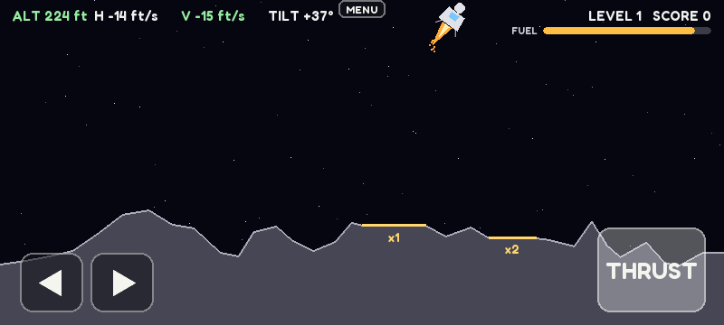

# Games (10.4" QLED)

Touch games for the Waveshare 10.4" QLED (1600x720 landscape, HDMI + USB touch), run by `play.py`.
Setup steps for the panel are in Notion: How-to Guides → "Quick start: Waveshare 10.4" QLED".

```bash
python play.py                  # the games menu (Pi, fullscreen)
python play.py hockey           # straight into a game
python play.py lander --window --zoom 1.5   # laptop window, mouse = one finger
python play.py hockey --fps     # show frame rate
```

Hold the **MENU** tab at the top centre for a second to go back to the menu. Esc or q quits.

| Preview | Game |
|---|---|
|  | **[Air Hockey](hockey/README.md)**<br>`python play.py hockey`<br>Two players, one at each end. First to 7. |
|  | **[Lunar Lander](lander/README.md)**<br>`python play.py lander`<br>On-screen rotate and thrust buttons; land softly on a pad. |

## Writing a game

Make `games/<name>/game.py` with a `Game` class:

```python
from playground.ui import Controls, Button, HoldButton, Slider, Stick

class Game:
    TITLE = "My Game"
    COLOR = (60, 90, 140)          # menu card colour
    SMOOTH = True                  # False: crisp pixels when scaled 2x

    @staticmethod
    def icon(surf): ...            # optional: draw the menu card picture

    def __init__(self, w, h):      # w, h = 800, 360 (the canvas)
        self.ui = Controls()
        self.jump = self.ui.add(Button((20, 300, 90, 44), "JUMP", on_tap=self.do_jump))

    def fingers(self, fingers):    # {finger id: (x, y)} every frame, canvas pixels
        free = self.ui.feed(fingers)   # fingers not on a control are yours

    def update(self, dt): ...      # fixed 1/60 s steps; call self.ui.tick(dt) for hold buttons
    def draw(self, surf):          # 800x360 Surface
        ...
        self.ui.draw(surf)
```

The canvas is 800x360 and is scaled 2x onto the panel by the GPU, so draw in canvas pixels
and keep touch targets at least ~40 px (about 0.45 in on the glass).

`DEMO_TOUCHES` (optional) scripts fingers for a headless screenshot:
`python play.py <name> --shot games/<name>/preview.png --frames 150`.
