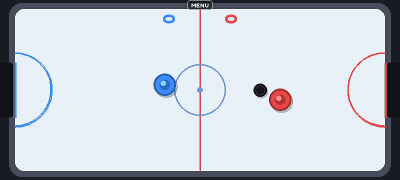

# Air Hockey

`python play.py hockey`

Two players, one at each short end of the panel. Put a finger anywhere in your half and your
mallet follows it; swipe through the puck to shoot. Scores face each player. First to 7 wins;
tap **Play again**.

## How it works

- pymunk: the puck is a dynamic circle with a little air damping; rails are static segments
  with gaps for the goals and a short box behind each.
- Mallets are **kinematic** bodies. Each frame their velocity is set to reach the finger in one
  frame (capped at 1600 px/s), so pymunk sees a real velocity and a fast swipe hits hard.
- 4 physics sub-steps per frame and a puck speed cap stop it tunnelling through rails.
- Multi-touch: the first finger to land in each half drives that half's mallet, so two players
  (or one person with two hands) can play at once.

## Ideas

- Sound on hits (the panel has a 3.5 mm jack and HDMI audio).
- A one-player mode with a simple AI mallet.
- Puck trail / spark on hard hits.
