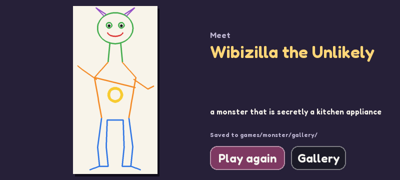

# Monster Mash-up



`python play.py monster`

A pass-the-screen drawing game for 3 or 4 artists (the parlour game "exquisite corpse").
Each artist draws one slice of a creature (Head, Body, Legs, and Feet with 4) and sees
only a thin strip of the previous slice's bottom edge, with markers where its lines
cross. When the last slice is done the whole monster is revealed top to bottom, given a
name and saved to `games/monster/gallery/` (not committed to git).

- **Tools:** 8 colours, eraser, 3 brush sizes, Undo, and Clear (hold).
- **Done** and **Hold to start** are hold-buttons, so nobody skips ahead or peeks by accident.
- The side panel tells you how many lines reach the bottom edge, so the next artist has
  something to join on to.

## How it works

- Strokes come from `trails()`: every point a finger passed through since the last frame,
  so curves stay smooth even when the Pi only manages 10 fps.
- Each slice is its own 440x290 picture; the reveal stacks them and pans down, then zooms out.
- Join markers: `edge_runs()` scans the last 3 rows of pixels for ink and groups neighbouring
  columns into one marker each.

## Test without the screen

```bash
python games/monster/selftest.py     # plays a whole scripted game, screenshots in games/monster/shots/
```

A step-by-step tutorial on how it was built is in Claude Docs ("Tutorial: Building Monster Mash-up").
