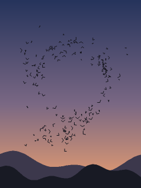
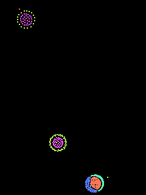
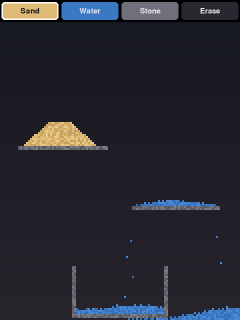

# Scenes

Each folder is one scene: `scene.py` (the code), `README.md` (what it is and how to play), `preset.json` (saved slider settings, if any) and `preview.png`.

Regenerate previews and this page with `python tools/make_previews.py`.

| Preview | Scene |
|---|---|
|  | **[Adult swim (GPU)](adultswim/README.md)** `python run.py adultswim` Adult swim: a quiet community pool at dusk, seen from above |
|  | **[Bouncing balls](balls/README.md)** `python run.py balls` Rigid-body balls in a box; tap to blast them apart |
|  | **[Flocking birds](boids/README.md)** `python run.py boids` A flock of birds wheeling over a dusk sky (boids) |
|  | **[Cloth (GPU)](cloth/README.md)** `python run.py cloth` Cloth: a gingham tablecloth that drops onto a ball. Grab it and pull it around |
|  | **[Cubes (GPU, 3D)](cubes/README.md)** `python run.py cubes` Cubes: turn a cube in space with your fingers, set it down, watch it fall |
|  | **[Grass in the wind](grass/README.md)** `python run.py grass` Low-resolution field of grass blowing in the wind |
|  | **[Lakeside hillside](hillside/README.md)** `python run.py hillside` A painted lakeside hillside: tall grass and pink plumes in the summer wind |
|  | **[Ink in water](ink/README.md)** `python run.py ink` Ink in water: stir coloured ink through a fluid with your finger |
|  | **[Meadow from above](meadow/README.md)** `python run.py meadow` A meadow seen from directly above |
|  | **[Meadow, hands in the grass](meadowtouch/README.md)** `python run.py meadowtouch` A meadow seen from directly above that you can run your hand through |
|  | **[Particle life](particlelife/README.md)** `python run.py particlelife` Particle life: coloured particles that chase and flee each other by type |
|  | **[Pin art (GPU)](pinart/README.md)** `python run.py pinart` Pin art: the desk toy with a bed of metal pins. Press and shapes rise out of it |
|  | **[Sunlit pool (GPU)](pool/README.md)** `python run.py pool` A sunlit swimming pool seen from above; touch the water to make ripples |
|  | **[Falling sand](sand/README.md)** `python run.py sand` Falling sand: pour sand, water and stone and watch them pile, flow and settle |
|  | **[Scratch-off at the corner store](scratchoff/README.md)** `python run.py scratchoff` Scratch-off tickets at the corner store: how many cards before you go bust? |
|  | **[Barley field](tallgrass/README.md)** `python run.py tallgrass` A barley field in the wind, seen from eye level; run your finger through it |
|  | **[Foggy car window](window/README.md)** `python run.py window` A foggy car window on a damp day in mountain farm country: wipe it to see out |
