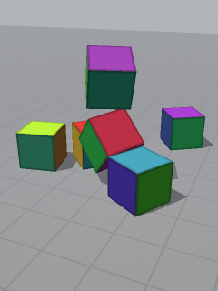
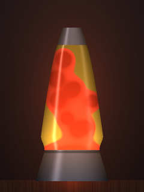
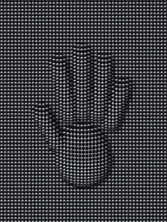
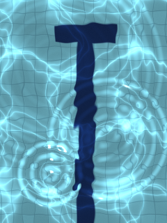
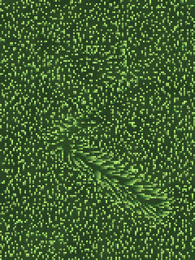
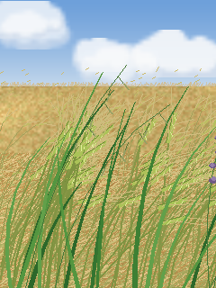
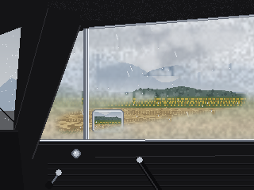

# Scenes

Each folder is one scene: `scene.py` (the code), `README.md` (what it is and how to play), `preset.json` (saved slider settings, if any) and `preview.png`.

Regenerate previews and this page with `python tools/make_previews.py`.

| Preview | Scene |
|---|---|
|  | **[Adult Swim](adultswim/README.md)** `python run.py adultswim` Adult swim: the sunlit pool, a little closer in, with swimmers |
|  | **[Laundry Day](cloth/README.md)** `python run.py cloth` Laundry Day: a striped sheet pegged on a clothesline in a meadow at golden hour |
|  | **[Block Party](cubes/README.md)** `python run.py cubes` Cubes: turn a cube in space with your fingers, set it down, watch it fall |
|  | **[Lava Lamp](lavalamp/README.md)** `python run.py lavalamp` Lava Lamp: warm wax rises, cools, and sinks, in a glowing glass rocket |
|  | **[Pin Art](pinart/README.md)** `python run.py pinart` Pin art: the desk toy with a bed of metal pins. Press and shapes rise out of it |
|  | **[Sunlit Pool](pool/README.md)** `python run.py pool` A sunlit swimming pool seen from above; touch the water to make ripples |

## Retired CPU scenes

The earlier scenes, drawn on the CPU. They're off the menu and the corner-hold cycle, but still run by name, e.g. `python run.py grass`.

| Preview | Scene |
|---|---|
|  | **[Bouncing balls](_cpu/balls/README.md)** `python run.py balls` Rigid-body balls in a box; tap to blast them apart |
|  | **[Flocking birds](_cpu/boids/README.md)** `python run.py boids` A flock of birds wheeling over a dusk sky (boids) |
|  | **[Grass in the wind](_cpu/grass/README.md)** `python run.py grass` Low-resolution field of grass blowing in the wind |
|  | **[Lakeside hillside](_cpu/hillside/README.md)** `python run.py hillside` A painted lakeside hillside: tall grass and pink plumes in the summer wind |
|  | **[Ink in water](_cpu/ink/README.md)** `python run.py ink` Ink in water: stir coloured ink through a fluid with your finger |
|  | **[Meadow from above](_cpu/meadow/README.md)** `python run.py meadow` A meadow seen from directly above |
|  | **[Meadow, hands in the grass](_cpu/meadowtouch/README.md)** `python run.py meadowtouch` A meadow seen from directly above that you can run your hand through |
|  | **[Particle life](_cpu/particlelife/README.md)** `python run.py particlelife` Particle life: coloured particles that chase and flee each other by type |
|  | **[Falling sand](_cpu/sand/README.md)** `python run.py sand` Falling sand: pour sand, water and stone and watch them pile, flow and settle |
|  | **[Scratch-off at the corner store](_cpu/scratchoff/README.md)** `python run.py scratchoff` Scratch-off tickets at the corner store: how many cards before you go bust? |
|  | **[Barley field](_cpu/tallgrass/README.md)** `python run.py tallgrass` A barley field in the wind, seen from eye level; run your finger through it |
|  | **[Foggy car window](_cpu/window/README.md)** `python run.py window` A foggy car window on a damp day in mountain farm country: wipe it to see out |
