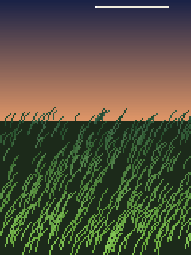

# Scenes

Each folder is one scene: `scene.py` (the code), `README.md` (what it is and how to play), `preset.json` (saved slider settings, if any) and `preview.png`.

Regenerate previews and this page with `python tools/make_previews.py`.

| Preview | Scene |
|---|---|
|  | **[Bouncing balls](balls/README.md)** `python run.py balls` Rigid-body balls in a box; tap to blast them apart |
|  | **[Grass in the wind](grass/README.md)** `python run.py grass` Low-resolution field of grass blowing in the wind |
|  | **[Meadow from above](meadow/README.md)** `python run.py meadow` A meadow seen from directly above |
