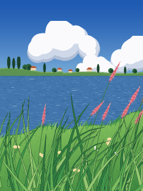

# Lakeside hillside



An original scene in a hand-painted animation style: deep blue summer sky and cumulus clouds over a lake, a far shore with cypress trees and red-roofed houses, and a grassy hillside in front with tall pink plumes and small flowers.

Inspired by the look of painted animation backgrounds; nothing is copied from any film.

```bash
python run.py hillside            # Pi
python run.py hillside --window   # laptop
```

## Touch

Your finger makes a **local breeze**: grass and plumes near it are pushed away from it. Drag to move the breeze. It fades out after you let go (**Touch breeze fade**). The ambient wind keeps blowing the whole time.

## How it works

Like hand-drawn animation, nearly everything is a **painted backdrop drawn once** at startup: sky, shore, lake texture, hill with brush strokes. Only wind-touched things move:

- **Clouds** drift slowly; **glints** flicker on the lake.
- **Grass blades** are tapered, outlined shapes. Each bends as a damped spring under the wind.
- **Plumes** have two springs: the stem, and the head on top of it. The head is kicked backwards when the stem accelerates, so it lags, whips and settles after gusts (**Plume head lag**).
- **Wind** = breeze + noise gusts rolling across + your local breeze.

## Settings worth playing with

| Setting | Try |
|---|---|
| Plume head lag | 0 for stiff plumes; 2–3 for floppy, trailing heads |
| Gust size / speed | Big and slow for rolling waves across the hill |
| Touch breeze size / strength | Small and strong for a puff; big and gentle for a passing gust |
| Pixel size | 2 for a chunkier, painterly look (also faster on the Pi) |

## Ideas

- Time of day: golden hour and dusk palettes, with the lake reflecting the sky
- A small boat crossing the lake
- Petals or seeds that blow off the plumes in strong gusts
- Drag sideways to pan along the shore (parallax layers)
