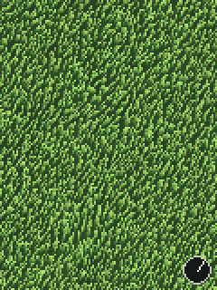

# Meadow from above



A meadow seen from directly overhead. At rest each blade is a 1×2-pixel stub; wind pushes the tips over, so the blades stretch into streaks pointing downwind. Ambient swirls and drifting local breezes keep the field moving.

```bash
python run.py meadow            # Pi
python run.py meadow --window   # laptop
```

## Touch

The wind blows **from the centre of the screen toward your finger**, in any direction; further from centre = stronger. Let go and it eases back to the **Idle wind** (set its direction with **Idle wind direction**). The compass in the corner shows the current wind.

## How it works

Wind at each blade is the sum of:

1. **Global wind**: your finger, or the idle wind.
2. **Ambient swirl**: a flow field where noise gives an angle and a strength everywhere, slowly drifting.
3. **Breezes**: local puffs that appear at random, drift across in their own direction, and fade in and out.

Each blade tip is a 2D damped spring. Drawing is vectorised with NumPy: every blade is sampled from root (dark) to tip (light) and written straight into a pixel array, so about 3,600 blades stay cheap.

## Settings worth playing with

| Setting | Try |
|---|---|
| Ambient swirl | Turn it up with touch wind at 0 for a field that breathes on its own |
| Breezes per second / size | Lots of small breezes = restless; a few big ones = calm with occasional gusts |
| Blade length vs spacing | Longer than the spacing gives a thick, carpet-like look |
| Palette | 0 summer, 1 dusk, 2 frost |

## Ideas

- Touch adds a local downdraft that flattens grass outward around your finger
- Paths: blades stay pressed down where you've dragged, then slowly recover
- Wildflowers that don't stretch, scattered through the grass
