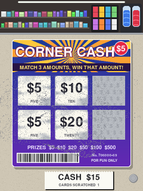

# Scratch-off at the corner store



A game: how many scratch cards can you play before your money runs out? You're at a corner-store counter (snack shelves, a ticket case and a slushie machine behind) with $20.

```bash
python run.py scratchoff            # Pi
python run.py scratchoff --window   # laptop
```

## How to play

1. Each card costs **$5**, taken from your cash on the receipt at the bottom.
2. **Scratch** the six silver fields with your finger. It takes a pass or two, and the scratched edges stay ragged.
3. The scratched-off latex turns into **dust** that piles up on the ticket. **Sweep** it away with your finger to see the numbers.
4. When every field is revealed, the card is stamped. If **three amounts match**, you win that amount and it's added to your cash.
5. **Tap** for the next card.
6. When you can't afford another card, you're **out of cash**. You see how many cards you scratched, your biggest win, your rank, and the five best runs (your run is highlighted).
7. Tap to play again with a fresh $20.

## The odds

Realistic, so in the long run you lose. About **1 card in 4** wins something, but the cards return only about **69%** of what you pay:

| Prize | Chance per card |
|---|---|
| $5 (your money back) | 12% |
| $10 | 7% |
| $20 | 3.5% |
| $50 | 1.2% |
| $100 | 0.4% |
| $500 | 0.08% |

Each card's outcome is decided when you buy it, then six amounts are laid out to match: a winner gets three of its amount, and no other amount ever appears three times. Losing cards are seeded with near-misses (pairs, big amounts) the way real ones are. **Luck** in the panel scales the odds.

## How it works

- **Coating:** a grid of "coating left" values over each field. Each frame your finger's path is a line segment; every cell within reach loses some coating, scaled by a fixed random roughness map, so edges are ragged and need a couple of passes.
- **Dust:** removed coating spawns particles that slide with friction. A moving finger sweeps the particles under it along. Dust is drawn by counting particles per cell, so it visibly piles up. Dust that leaves the ticket stays on the counter; dust on the ticket goes with the old card.
- **Reveal:** a field counts as revealed once most of its coating is gone (**Reveal at**).
- **Scores** are saved in `~/.config/physics-display/scratchoff_scores.json`. Delete it to reset the leaderboard.

## Settings worth playing with

| Setting | Try |
|---|---|
| Luck | 3 for a lucky streak; 0.2 for a fast bust |
| Scratch size / strength | Small and weak for a coin edge; big and strong for quick scratching |
| Dust amount / Sweep strength | Lots of dust that's hard to sweep, for the real experience |
| Starting cash / Card price | Higher stakes |
