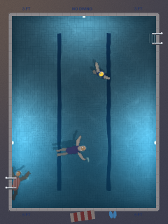

# Adult swim (GPU)



A quiet community pool at dusk, seen from above. The underwater lights are on, the deck lamp glints off the ripples, and nobody's in a hurry.

You're the swimmer in the **yellow cap**, treading water. **Tap anywhere in the pool** and you swim there with a slow, head-up breaststroke, then tread water again. Other people wander in down the ladders and do their thing:

- someone swims a few lazy lengths
- someone floats on their back
- someone hangs on a pool noodle
- someone drifts over for a chat

After a while they climb out and leave.

```bash
python run.py adultswim --gpu
```

## How it works

Three layers:

1. **The water surface** is a small wave simulation: a grid of heights, one cell per 5 screen pixels, updated with the wave equation (each cell is pulled toward the average of its neighbours). Swimmers poke it:
   - hands on every stroke
   - a soft bow wave at the head
   - little sculling ripples while treading

   Ripples spread, bounce off the walls and pass through each other. The slopes go to the GPU as a texture each frame.
2. **Bodies under the water** are drawn each frame from simple capsules (torso, upper and lower arms, legs) into a half-resolution image:
   - breaststroke: arms sweep out, meet under the chin and shoot forward; then a frog kick and a glide
   - treading: sculling arms and eggbeater legs
3. **The shader**, for every pixel:
   - bends the view of the floor tiles and the bodies by the surface slope (refraction)
   - adds the bodies' soft shadows on the floor
   - adds the glow of the underwater lights and the water's colour, deeper toward the deep end
   - reflects the dusk sky at the surface, with lamp glints on the ripples

Heads are above water, so they're drawn crisp on top, unbent (cap or hair, face toward where they're going). The deck, coping, ladders and towel are painted once into an overlay with the pool cut out.

## Settings worth playing with

| Setting | Try |
|---|---|
| Other swimmers | 0 for a pool all to yourself |
| Comings and goings | 3 for a busier evening |
| Swim pace | 2 if you're in a hurry |
| Ripple fade | 0.3 and every stroke rolls on for ages |
| Pool lights / Dusk sky | Lights 2, dusk 0 for night |
