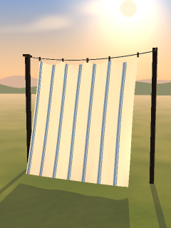

# Laundry Day (GPU)



A striped sheet pegged on a clothesline in a meadow at golden hour. The low sun is behind it, so the fabric glows where the light comes through, and a gusty breeze makes it billow. Long evening shadows lie across the grass; hazy hills and slow clouds sit on the horizon.

- **Drag the sheet:** pull that spot (a finger each, up to three). Let go and it swings back.
- **Drag the sky or grass:** look around. **Pinch:** zoom.
- **Double-tap:** unpeg it, and it blows off and drops onto the grass. Double-tap again to hang a fresh one.

Switch **Setup** to *Over a ball* for the original scene: a cloth dropped over a ball. **Pattern** picks stripes, red gingham or plain linen.

```bash
python run.py cloth --gpu
```

## How it works

- **Particles and constraints (Verlet cloth).** The sheet is a 24 × 24 grid of particles. Each remembers where it was last step, so its velocity is just "now minus before". That makes dragging easy: move a particle by hand and it has a velocity for free.
- **Each frame:** gravity and the breeze move every particle (the breeze pushes on the face of the cloth, so it billows). Then the constraints are relaxed six times:
  - straight neighbours keep it from stretching
  - diagonal ones stop it shearing
  - pairs two apart give it a little stiffness to fold
- **Pegs** are particles that never move. A finger pinches a small patch of particles; letting go hands them back, so pegged ones stay pegged.
- **Cheap on the Pi:** numpy works on whole slices of the grid at once, so a frame is a few dozen array operations whatever the size.
- **Drawing:** the sheet is uploaded as a fresh mesh every frame.
  - Both sides are lit, and the pattern and weave are worked out per pixel.
  - When the sun is behind the side you're looking at, light "comes through" in warm colours.
  - Posts, line and pegs are simple boxes with glowing rims from the backlight.
  - The sky, sun, clouds and hills are one full-screen shader that knows where the horizon and sun fall on screen.

## Settings worth playing with

| Setting | Try |
|---|---|
| Breeze | 3 for a proper blustery day; 0 and it hangs still |
| Clothespins ↻ | 2 for a sheet hanging by its corners |
| Fold stiffness | 0 for silk, 1 for canvas |
| Solver passes | 2 is stretchy and rubbery; 12 is crisp (slower) |
| Cloth detail ↻ | 36 for finer folds (slower on the Pi) |
