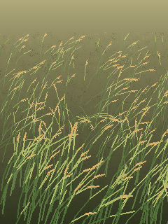

# Tall grass, up close



A stand of tall grass with grain heads, seen from above and to one side, as if you were standing next to it. An ambient breeze keeps it moving; your finger is a hand moving through the grass.

```bash
python run.py tallgrass            # Pi
python run.py tallgrass --window   # laptop
```

## Touch

Touch and drag through the grass. Blades near your finger are pushed aside, and dragging sweeps them along with you. Hold still and a gap opens around your finger. Let go and they spring back with a wobble.

## How it works

- **Perspective:** blades are rooted on a ground plane viewed at an angle (**View angle**). Far blades sit higher on the screen and are shorter; near blades are taller and their roots run off the bottom.
- **Each blade tip is a 2D spring** on the ground: left/right and toward/away from you. Its shape is projected to the screen, so bending toward you moves the tip down and makes the blade look shorter.
- **Breeze:** noise gusts roll across, mostly left to right, with a little toward/away swirl.
- **Hand:** for each blade, the nearest point on its upper part to your finger gets pushed away, plus a pull in the direction you're moving.
- **Grain heads** are heavier, so those blades respond more slowly and their heads droop.

## Settings worth playing with

| Setting | Try |
|---|---|
| Hand size / push / drag | Big size + low push for brushing; small + high push for poking |
| Blade damping | Low for a long wobble after you let go |
| View angle | 30 for nearly side-on, 70 for nearly top-down |
| Grain weight | High for heavy, nodding heads |

## Ideas

- Blades stay bent where you've walked, then slowly recover (trampled path)
- Seeds that shake loose and drift when you brush hard
- Insects that scatter from your finger
