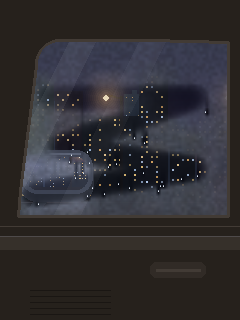

# Foggy car window



Riding in the passenger seat through a city at night. The side window is fogged up; wipe it with your finger to see out. The fog slowly comes back.

```bash
python run.py window            # Pi
python run.py window --window   # laptop
```

## Touch

Swipe to wipe the condensation away: you're drawing on the window. Through the clear patches you see the city sliding past and the side mirror at the front corner of the glass. Droplets gather at the edges of your wipes and run down the glass.

## How it works

- **The city** is made of looping layers drawn once at startup: a far skyline, nearer buildings with lit windows and neon signs, and street lamps with soft glows. Each layer scrolls at a different speed (parallax). The car's front is to your left, so everything slides left to right.
- **The side mirror** is outside the glass, so it's under the fog too. Its glass shows a flipped slice of the street.
- **The fog** is a coarse density map over the glass. Each frame, a heavily blurred, brightened copy of the view is laid over the clear view, with the fog density as its transparency. Under thick fog you only see glowing blobs of light.
- **Weight:**
  - Fog grows back patchily, faster in some spots than others (**Fog return time**), and creeps in from foggy neighbours (**Fog creep**), so wipe edges soften and close in.
  - Droplets run down, catch on the glass for a moment, then carry on, cutting thin clear trails that fog over again.
- **Light:** when a street lamp passes the window, the car interior briefly lights up.

## Settings worth playing with

| Setting | Try |
|---|---|
| Driving speed | 0 to sit at a red light |
| Fog return time | 3 for a cold night where it fogs right back; 40 for a lazy return |
| Fog creep | 0 for crisp drawn lines that just fade; 2+ for edges that close in |
| Drips from wipes / Random drips | Up for a wetter window |
| Fog brightness | Higher for milky, glowing fog |

## Ideas

- Rain on the outside of the glass, with drops streaking sideways at speed
- Traffic lights that stop and start the drive
- Writing with a fingertip leaves a faint ghost that reappears when the fog returns (like real glass)
